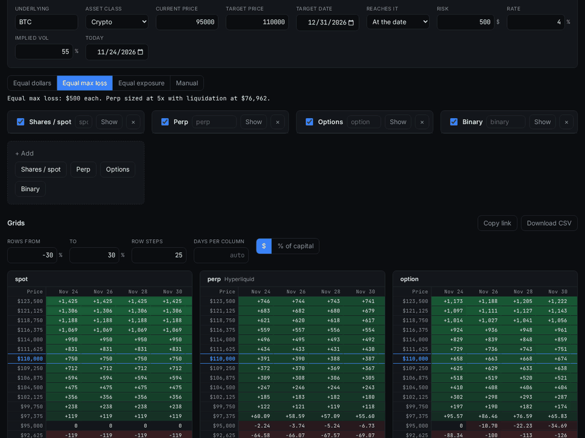

# ThesisGrid

**Same thesis, every instrument, one grid.**

**[Open ThesisGrid](https://hunterm777.github.io/ThesisGrid/)** · runs entirely in your browser, no sign-up, nothing you type leaves the page.



Type one thesis, such as `BTC to 120k by Dec 31` or `NVDA to $200 by Mar 20`, and ThesisGrid shows what it pays to express it through **shares or spot**, **perps**, **options** and **prediction-market binaries**, each on the same price × date P&L grid. It covers crypto, single stocks, indices and ETFs, and commodities.

You choose what a fair comparison means, and can switch at any time:

- **Equal dollars:** the same cash goes into each instrument.
- **Equal max loss:** each position is sized so its worst case is the same.
- **Equal exposure:** each position starts with the same dollar delta.
- **Manual:** you set each size yourself.

Every input is editable: prices, strikes, implied volatility, leverage, funding, fees, dates and the grid's ranges. Venue presets for **Kalshi**, **Polymarket** and **Hyperliquid** fill in fees, funding rules and leverage limits as of 2026-11-24, and any preset value can be overridden. There is no backend, no API and no market data: every number on the page comes from what you type in.

> Not financial advice. Numbers are model estimates from your inputs, and the tool never recommends an instrument.

## What it models

| Instrument | Model |
| --- | --- |
| Shares / spot | Linear P&L, entry and exit fees, an optional stop for max-loss sizing. |
| Perps | Leverage, maintenance margin, funding charged on entry notional each period, the venue's liquidation price with funding included, maker or taker fees. Cells the price can't reach without crossing liquidation are marked. |
| Options | Black-Scholes, or Black-76 for options on futures (chosen per position), time to expiry on a 365-day calendar for stocks, indices and crypto (how listed-option IVs are quoted), full Greeks, 12 named strategies from long calls to iron condors and butterflies, or custom legs. |
| Binaries | Digital option pricing (pays at or above the strike, or inside a range), implied vol solved from the contract price, Kalshi and Polymarket fee schedules. |

Each grid shows P&L in dollars or as a percent of capital, with the target price row and target date column marked. A summary table gives size, cost, max loss, max gain, breakeven and P&L at target, and a payoff chart overlays every instrument at the target date. A scenario travels as a link (the whole scenario lives in the URL hash) and exports to CSV or PNG.

## Python

The same Rust core is available from Python, so a scenario returns the same numbers as the page to the cent.

```python
import thesisgrid as tg

thesis = tg.Thesis(spot=95_000, target=110_000, target_date="2026-12-31",
                   rate=0.04, iv=0.55)

legs = [
    tg.Spot(side="long", stop=85_000),
    tg.Perp.preset("hyperliquid", side="long", leverage=5, funding_8h=0.0001),
    tg.Option.strategy("bull_call_spread", strikes=(100_000, 115_000),
                       expiry="2026-12-31"),
    tg.Binary.preset("kalshi", side="yes", strike=110_000,
                     expiry="2026-12-31", price=0.31),
]

result = tg.compare(thesis, legs, mode="equal_max_loss", budget=500,
                    prices=tg.range_pct(-0.3, 0.3, steps=25),
                    dates=tg.daily("2026-11-24", "2026-12-31"))

result.summary()      # cost, max loss, max gain, breakeven, P&L at target
result.grid("perp")   # NumPy array, price x date
result.to_pandas()    # long-format cells (needs pandas)
result.to_url()       # the same scenario as a ThesisGrid page link
again = tg.from_url(result.to_url())   # load a scenario shared from the page
```

The quick-entry phrase works too: `tg.parse("NVDA to $200 by Mar 20", spot=182.40, iv=0.48)`. Prices in these examples are illustrative inputs, not market data.

The package needs Python 3.10 or later and is not on PyPI yet. Build it from source with [maturin](https://www.maturin.rs/):

```bash
pip install maturin
maturin build --release -m crates/python/Cargo.toml --out wheels
pip install wheels/*.whl
```

## How it's built

```
crates/core     all the math, in Rust, with no I/O
crates/wasm     wasm-bindgen wrapper for the page (no logic of its own)
crates/python   PyO3 wrapper built with maturin (no logic of its own)
web/            TypeScript (strict) + Vite page, dark mode, WASM inlined
fixtures/       shared scenarios and expected results
```

One core means the page and the Python package can't drift apart. These checks run in CI on every push:

- **Parity:** the same fixture scenarios run through the native Rust build, the WASM build (in Node) and the Python wheel, and every number must match to 1e-9.
- **Pricing:** Black-Scholes, Black-76 and digital values and Greeks are checked against 50-digit reference values (`tools/gen_pricing_fixtures.py`, using mpmath), plus put-call parity on every case.
- **No network:** the Python tests fail if anything opens a socket. The page's build check rejects any fetch, XHR, WebSocket or remote asset, and its CSP sets `connect-src 'none'`. A headless-Chrome check confirms no request goes out after load.
- **Speed:** a full recompute and redraw of four 25 × 30 grids is timed in headless Chrome against a 16 ms budget.
- **Size:** the WASM module must stay under 300 KB gzipped.
- **Quality:** `cargo fmt`, `cargo clippy -D warnings`, TypeScript strict mode, modules under about 300 lines.

### Run it locally

```bash
# Rust core and fixtures
cargo test --workspace --exclude thesisgrid-python

# The page (needs wasm-bindgen-cli 0.2.130 and the wasm32-unknown-unknown target)
cd web && npm ci && npm run wasm && npm run dev

# The Python package
pip install maturin && maturin develop --release -m crates/python/Cargo.toml
pytest crates/python/tests
```

## License

[MIT](LICENSE)
